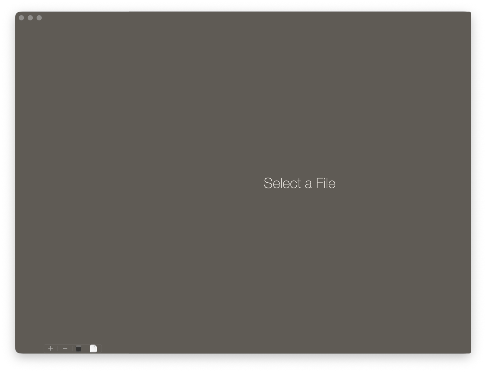
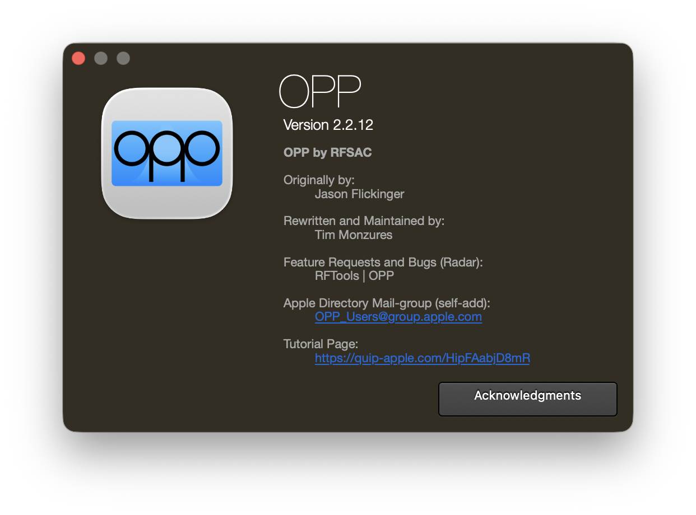

# OPP Research Archive

This repository preserves public-safe research notes and screenshots from an independent inspection of **OPP 2.2.12 (build 27)**, a macOS application associated with Apple's RFSAC group.

Research date: **2026-10-06**

## What is included

- Two application screenshots captured during local inspection.
- A concise technical metadata record.
- Research notes describing features observed in the app bundle and executable.
- Checksums for the files published in this repository.
- A provenance record for the private evidence archive used during the investigation.

## What is not included

This repository does **not** redistribute the OPP application binary, bundled frameworks, private source code, credentials, or internal documentation. Internal service URLs, mailing-group addresses, and similar operational identifiers have been omitted from the public archive.

## Summary

Observed characteristics of the inspected build include:

- Version: 2.2.12 (27)
- Bundle identifier: `com.apple.OPP`
- Platform: macOS
- Architecture: x86_64
- Minimum macOS version: 10.12
- Registered document type: CSV
- Build toolchain observed in metadata: Xcode 14.1 / macOS 12.3 SDK
- Graphing framework: CorePlot
- Update framework: Sparkle
- Apple Developer ID signature and stapled notarization ticket were present on the inspected copy

The app contains plotting and statistical features for engineering test data, including grouped plots, histograms, CDFs, correlation plots, time-series views, averages, standard deviations, limits, Cpk values, counts, and serial-number information. The inspected build also contains RF/hardware-test-related measurement names.

## Screenshots

### Main window

### About window

## Notes on ownership

The research notes and organization in this repository were prepared by the repository author. Apple software, interface elements, names, trademarks, and other third-party material remain the property of their respective owners. The screenshots are included for documentation and identification purposes and are not relicensed as original software artwork.
